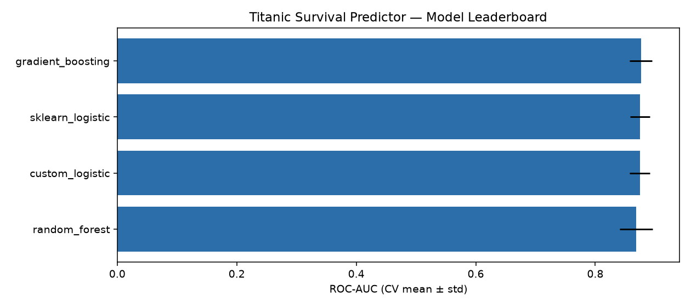
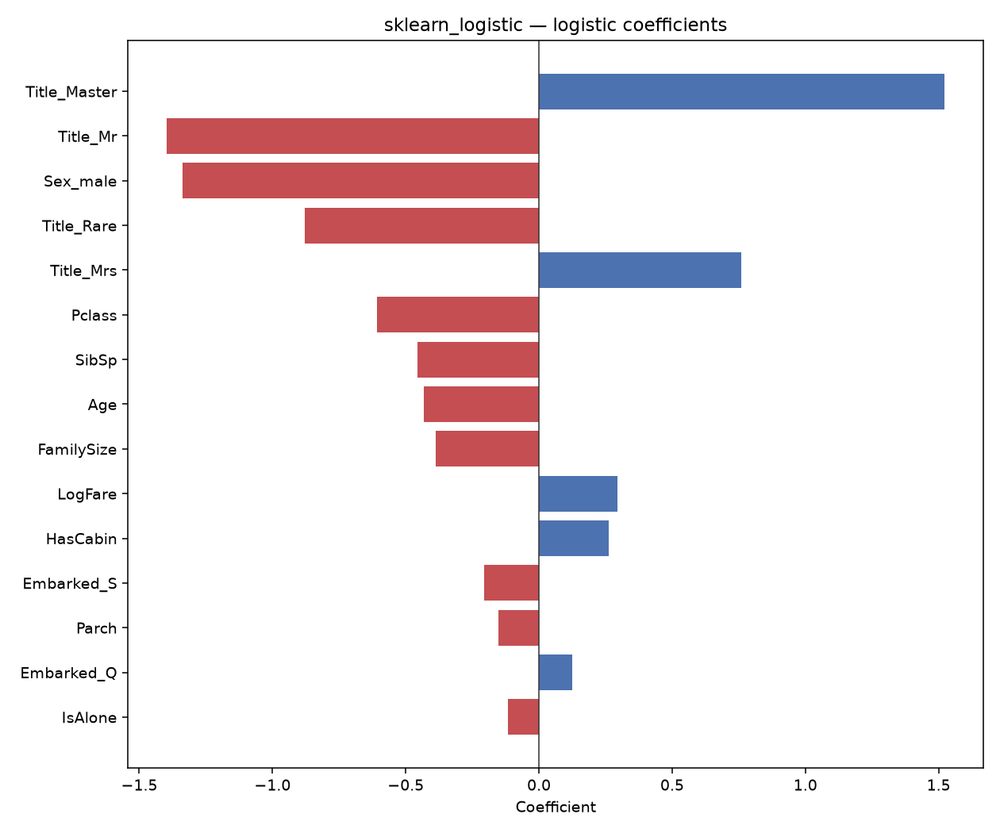
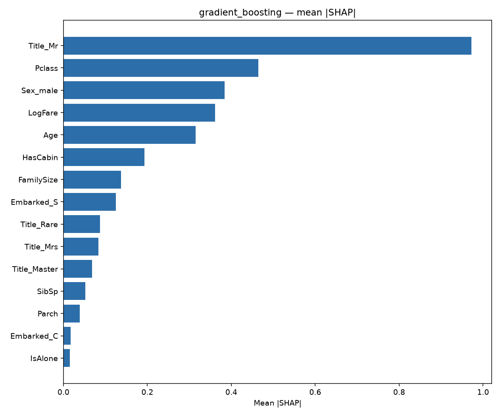
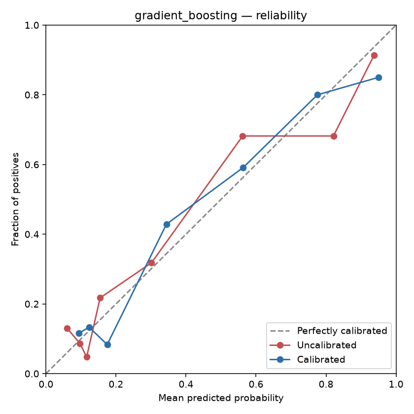
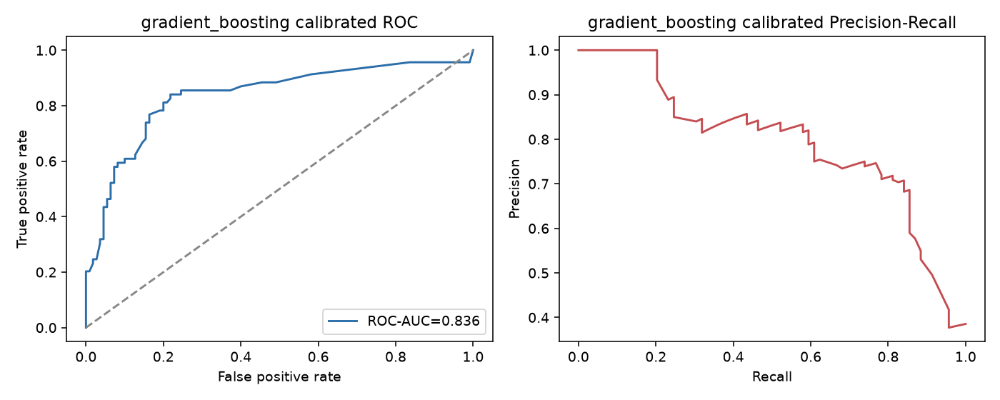
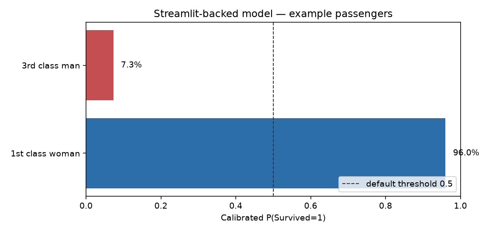

# Titanic Survival Predictor

**Interpretable binary classification with a from-scratch logistic regression core — plus leak-safe CV, tuning, calibration, SHAP, a Kaggle submission path, and a Streamlit demo.**

[](https://www.python.org/)
[](https://scikit-learn.org/)
[](https://www.kaggle.com/c/titanic/data)

---

### Why this project exists

Most Titanic tutorials call `LogisticRegression().fit(...)` and stop. This repository goes further:

1. **Derive and implement** logistic regression from the likelihood and its gradient.
2. **Impute missing ages inside each CV fold** (scaled k-NN or group medians) — no leakage.
3. **Engineer features** that encode social structure (title, family size, cabin presence).
4. **Compare models fairly** with stratified cross-validation, then **explain** them with coefficients + SHAP.
5. **Ship a Kaggle submission** with one command.

The result is a portfolio piece that shows *statistical understanding*, *clean engineering*, and *honest evaluation*.

---

## Highlights

| Capability | Detail |
|---|---|
| Custom MLE logistic regression | Vectorized gradient ascent, scikit-learn-compatible API |
| Leak-safe Pipelines | Feature build → age impute → encode/scale nested in CV |
| Feature engineering | Title, FamilySize, IsAlone, HasCabin, LogFare |
| Model zoo | Custom LR · sklearn LR · Random Forest · Gradient Boosting |
| Evaluation | Stratified 5-fold CV (Accuracy / F1 / ROC-AUC) + holdout |
| Kaggle submission | `scripts/make_submission.py` → `submission.csv` |
| Interpretation | Coefficient tables + SHAP mean \|SHAP\| rankings |
| Hyperparameter tuning | RandomizedSearchCV over logistic / GBM / RF Pipelines |
| Calibration | Isotonic/Platt + F1-optimal decision threshold |
| Interactive demo | `streamlit run app.py` |
| CI | GitHub Actions: pytest + smoke benchmark |
| Walkthrough notebook | Math, EDA, and benchmark in `TitanicSurvivalPredictor.ipynb` |

---

## Quick start

```bash
# Clone
git clone https://github.com/juandapradam12/TitanicSurvivalPredictor.git
cd TitanicSurvivalPredictor

# Install
python -m venv .venv
source .venv/bin/activate   # Windows: .venv\Scripts\activate
pip install -r requirements.txt

# Benchmark (leak-safe CV)
python3 scripts/train_and_evaluate.py

# Kaggle submission (auto-picks best CV model)
python3 scripts/make_submission.py --model auto

# Coefficients + SHAP figures
python3 scripts/interpret_model.py --model sklearn_logistic
python3 scripts/interpret_model.py --model gradient_boosting

# Tune + calibrate (optional but recommended before serving)
python3 scripts/tune_model.py --model gradient_boosting --n-iter 20
python3 scripts/calibrate_and_threshold.py --model gradient_boosting

# Interactive demo
streamlit run app.py

# Notebook
jupyter notebook TitanicSurvivalPredictor.ipynb
```

On the engineered feature set with **fold-safe preprocessing**, stratified 5-fold CV typically lands around **~83–84% accuracy** and **~0.88 ROC-AUC**. Gradient Boosting usually leads; the **custom logistic regression stays within ~1 point of scikit-learn’s**.

---

## Project layout

```text
TitanicSurvivalPredictor/
├── TitanicSurvivalPredictor.ipynb
├── train.csv / test.csv
├── requirements.txt
├── src/titanic_predictor/
│   ├── custom_logistic.py      # From-scratch logistic regression
│   ├── preprocessing.py        # Leak-safe feature / impute / encode Pipelines
│   ├── features.py             # Feature helpers
│   ├── imputation.py           # Classic k-NN helpers
│   ├── models.py               # Model zoo + CV
│   ├── interpretation.py       # Coefficients + SHAP
│   └── pipeline.py             # Benchmark, submit, interpret entry points
├── app.py                           # Streamlit demo
├── scripts/
│   ├── train_and_evaluate.py
│   ├── make_submission.py
│   ├── interpret_model.py
│   ├── tune_model.py
│   └── calibrate_and_threshold.py
├── .github/workflows/ci.yml
├── tests/
├── figures/
└── docs/
    ├── METHODOLOGY.md
    ├── ALGORITHMS.md
    ├── INTERPRETATION.md
    ├── TUNING_AND_CALIBRATION.md
    └── PROJECT_OVERVIEW.md
```

---

## The math (short version)

For labels $y_i \in \{-1,+1\}$,

$$
\nabla_w \mathcal{L}
  = \sum_{i=1}^{n}
    \bigl(1 - \sigma(y_i\, x_i^\top w)\bigr)\, y_i\, x_i,
\quad
\sigma(z)=\frac{1}{1+e^{-z}}.
$$

Weights are updated by gradient ascent. The package version is **vectorized**, supports **early stopping**, and exposes `coef_`, `predict_proba`, and `predict` like any scikit-learn classifier.

Full derivation: [docs/ALGORITHMS.md](docs/ALGORITHMS.md).

---

## Example output

**Model leaderboard (stratified 5-fold CV).** Mean ROC-AUC with error bars for each model in the zoo. Gradient Boosting leads; the custom logistic estimator stays within ~1 point of scikit-learn’s, which is the interpretability trade-off this project is built around.

<p align="center">
  
</p>

```text
================================================================
 Titanic Survival Predictor — Model Benchmark
================================================================
Samples: 891  |  Features: 17
Best model (by ROC-AUC CV): gradient_boosting

            model  accuracy_mean  f1_mean  roc_auc_mean
gradient_boosting         0.8406   0.7785        0.8816
    random_forest         0.8328   0.7687        0.8775
 sklearn_logistic         0.8283   0.7729        0.8768
  custom_logistic         0.8283   0.7711        0.8759
```

### What drives survival?

**Logistic coefficients (sklearn).** Largest-magnitude coefficients after leak-safe preprocessing. Positive bars raise log-odds of survival (e.g. `Title_Master`, `Title_Mrs`); negative bars lower them (e.g. `Title_Mr`, `Sex_male`, higher `Pclass` number).

<p align="center">
  
</p>

**SHAP importance (Gradient Boosting).** Mean absolute SHAP values on a held sample of passengers. Title, sex, and class again dominate — the non-linear model recovers the same social structure as the linear coefficients.

<p align="center">
  
</p>

### Calibration & discrimination

**Reliability curve.** Predicted probability vs. observed survival rate before and after isotonic calibration. Closer to the diagonal means better-calibrated probabilities for decision thresholds and the Streamlit demo.

<p align="center">
  
</p>

**ROC and precision–recall.** Holdout discrimination for the calibrated Gradient Boosting model — ROC summarizes ranking quality; PR focuses on the minority survived class.

<p align="center">
  
</p>

**Example passenger predictions.** Calibrated survival probabilities for two archetypes used to sanity-check the serving model (first-class woman vs. third-class man).

<p align="center">
  
</p>

Tune with `scripts/tune_model.py`, calibrate and pick an F1-optimal threshold with `scripts/calibrate_and_threshold.py`, then explore interactively via `streamlit run app.py`.

---

## Documentation

- [Methodology](docs/METHODOLOGY.md) — leak-safe Pipelines, features, CV
- [Algorithms](docs/ALGORITHMS.md) — custom logistic regression & imputation
- [Interpretation](docs/INTERPRETATION.md) — coefficients & SHAP
- [Tuning & calibration](docs/TUNING_AND_CALIBRATION.md) — search spaces, Brier, thresholds
- [Project overview](docs/PROJECT_OVERVIEW.md) — elevator pitch & design principles
- [Notebook](TitanicSurvivalPredictor.ipynb) — exploratory analysis and live training

---

## Testing

```bash
python3 -m pytest tests/ -q
```

---

## Data credit

Passenger records come from Kaggle’s
[Titanic: Machine Learning from Disaster](https://www.kaggle.com/c/titanic/data)
competition. `train.csv` and `test.csv` are included so the submission script runs out of the box.

---

## Author

**Juan David Prada Malagón** — data scientist.
